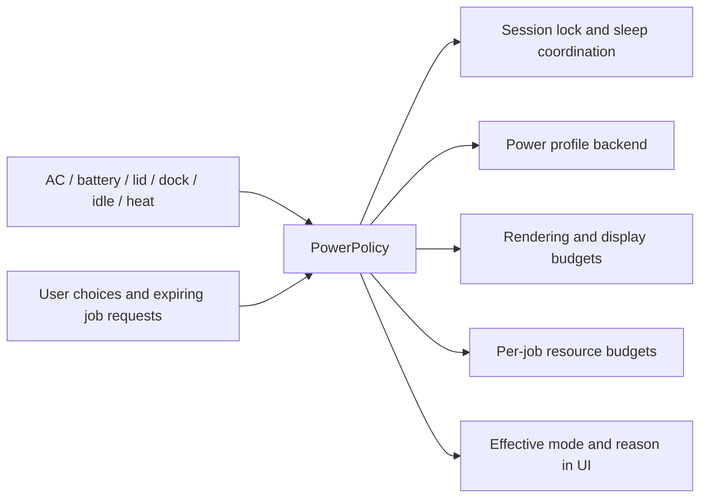

# iRice: feature gaps, session reliability, and power/performance strategy

Date: **29 October 2026**, Asia/Kolkata. Reviewed source: **`483d6eb`**.

This document complements the [bug audit](bug-audit-2026-10-28.md). It records missing or incomplete capabilities, investigates the reported sleep/lock and window-layout failures, and proposes a product and engineering direction. **Implementation code and live power/window settings were not changed.** Suggestions below are proposed behavior, not features already delivered.

**Implementation follow-up (29 October):** the bug-fix pass now implements the idle/pre-sleep lock path, floating/tiled rule fixes, truthful notification capabilities and the approved minimal TTY-style greeter. See the [audit implementation status](bug-audit-2026-10-28.md#implementation-status--29-october-2026) for each correction and test limits. The original analysis below is historical evidence. Lid/suspend hardware acceptance remains pending; the proposed unified power policy, lid-closed frequency tuning and competitive-feature roadmap are still proposals, not delivered features.

## 1. Main conclusions

1. **Returning from sleep without a lock is an actual session-integration defect in the current launch path.** There is no lock-on-wake setting overriding a working implementation. The active TTY session omits the idle/lock daemon and has no independent logind sleep-lock listener.
2. **The floating-default problem has a reproduced code cause.** Its change handler reads a derived boolean before that binding updates, generating the previous layout policy. Existing-window rearrangement runs later and sees the new value. Startup-rule persistence has a separate missing trigger.
3. **Power features exist, but they do not form one coherent policy.** Low Power, visual Cool-down, heat throttling, Game Mode, Caffeine, and logind lid behavior have different owners. Adding more independent toggles would make their interactions harder to predict.
4. **A strong competitive position is a beautiful desktop that reliably explains and controls its energy use.** The immediate opportunity is finishing workflows and lifecycle behavior, then adding device continuity, automation, accessibility, and extensibility.
5. **No evidence currently establishes iRice or its base distro as the fastest or most efficient.** That ambition needs controlled comparisons, a hardware support matrix, and regression budgets. CPU clock frequency alone cannot establish efficiency.

## 2. What was investigated and what the evidence means

The source inventory covered **375 tracked source/configuration files**, including **61 QML services**, **28 Settings pages**, and **272 declared Config properties**. These counts describe the inventory, not a claim that every runtime combination was exercised. The follow-up traced settings through consumers, generated configuration, commands, backend availability, and session startup; it also inspected the actual laptop/session state and consulted primary platform documentation.

Evidence levels used here:

- **Live observation:** read-only evidence from the current laptop/session.
- **Reproduced:** an isolated test using the actual service code, with dependencies identified below.
- **Source-confirmed:** the implementation or omission is visible in the reviewed source.
- **Proposal:** recommended future behavior; no measured benefit is claimed yet.
- **External integration:** delivered through another application/service, with its own capabilities and limitations.

The active shell runs from `/home/user/iRice`; that checkout reports the same reviewed commit, and the window-rules service and TTY startup file match the corresponding files in this workspace. Its settings come from that checkout's `.sandbox/home`, rather than the usual `~/.config/irice` directory. That distinction matters when checking whether a setting has taken effect.

No real suspend, lid-close action, compositor reload, frequency write, daemon installation, or window rearrangement was initiated for this analysis. The window-rules experiments ran offscreen with a fake `hyprctl` and a stub Hyprland event source. A candidate correction was tested only in a temporary copy. The previous audit's syntax checks and 27 passing tests remain historical evidence; they were not relabelled as new end-to-end tests here.

The literal-reference inventory initially flagged `startupFile` and `chargingFile`, but [Sounds.qml](../shell/services/Sounds.qml#L60) accesses them dynamically as `cfg[key + "File"]`. They are wired and are not missing-feature findings. A missing literal reference alone is insufficient evidence of a dead setting.

## 3. Sleep, lid, Caffeine, and lock diagnosis

### 3.1 What the laptop was actually doing

Read-only snapshot taken at approximately **08:15 IST on 29 October**:

| Observation | Result | Meaning |
|---|---|---|
| Active compositor configuration | `sandbox/hypr/tty.lua` | This is the TTY/login-session path, not the installed configuration's `execs.lua` path. |
| Shell environment | `IRICE_TTY=1`; `IRICE_SANDBOX` absent | Real session; power operations are not merely sandbox notifications. |
| Idle/standalone lock processes | No `hypridle`, `hyprlock`, or `swaylock` process found | iRice has its own locker, but the ordinary sleep/idle integration daemon is absent. |
| Saved Caffeine state | Enabled indefinitely (`until: 0`) | Current keep-awake preference is active; this snapshot does not prove its state at every earlier suspend. |
| iRice inhibitor | `idle`, block mode | It prevents idle handling, not arbitrary explicit suspend or low-level lid-switch handling. |
| Effective logind lid action | `suspend`; docked action `ignore` | The system, rather than iRice, currently decides lid behavior. |
| Session lock hint | Unlocked at inspection | Expected while working; the hint alone is not evidence of whether the session was secure during an earlier resume. |
| Recent logind journal | Lid-close suspends and completed resumes around 07:51–07:52 IST | Sleep itself is happening. The failure is the missing lock integration around it. |

The inspected main logind configuration had no active custom lid override. Effective D-Bus properties were checked rather than relying only on commented defaults. In logind, idle inhibition, sleep inhibition, and taking ownership of lid-switch handling are distinct mechanisms. [systemd logind configuration](https://www.freedesktop.org/software/systemd/man/latest/logind.conf.html)

### 3.2 The missing chain

The installed configuration starts `hypridle` in [execs.lua](../hypr/irice/execs.lua#L8). Its [idle configuration](../hypr/hypridle.conf#L4) asks logind to lock before sleep and routes locking to the shell. However:

- The active [TTY startup](../sandbox/hypr/tty.lua#L49) does **not** load `execs.lua` or start `hypridle`.
- [System.qml](../shell/services/System.qml#L109) invokes `systemctl suspend` without first obtaining a secure session lock.
- No independent `PrepareForSleep`/logind `Lock` listener was found in the shell.
- [Lock.qml](../shell/modules/lock/Lock.qml#L163) has a five-minute idle lock tied to StandBy, charging, and Caffeine being off. That is not a general sleep-lock service.
- [Lock settings](../shell/modules/settings/pages/lock.qml) concern appearance, previews, transitions, and StandBy. There is no implemented “require password after sleep” control whose value explains away the missing integration.

**Verdict:** the source and live session support a wiring bug, consistent with the reported unlocked resume. Caffeine suppressing idle locking is intentional current behavior; it does not justify bypassing security when the machine actually suspends. An actual suspend/resume regression test remains necessary when implementing the correction.

### 3.3 Starting a daemon is necessary but not the whole correction

The repair should cover every supported launch path and use the actual shell instance/binary, including the TTY shell's private XDG paths. Simply copying an IPC command that targets `qs -c irice` can target the wrong configuration if the running shell was started with `-p <checkout>/shell`.

The invariant should be: **acquire the compositor lock before suspend; preserve it across resume; never expose an interactive desktop frame before authentication.** Caffeine should not override this invariant. A sleep-delay inhibitor should be released on a secure-lock acknowledgement, not just on successful command launch. Hypridle documents explicit secure-lock waiting for custom lockers; logind's lock command sends a signal rather than waiting for a rendered locker. [Hypridle sleep/lock guidance](https://wiki.hypr.land/hypr-ecosystem/user/hypridle/), [logind D-Bus lifecycle](https://www.freedesktop.org/software/systemd/man/latest/org.freedesktop.login1.html)

The earlier audit's [R02](bug-audit-2026-10-28.md#r02--the-lock-animation-starts-before-the-compositor-is-actually-locked) also matters: the fade/zoom currently delays actual lock acquisition by 400 ms. Secure first, then animate within the secured surface. Add a bounded failure path that reports a locker failure rather than silently considering the machine protected.

### 3.4 Caffeine currently behaves as documented, but lacks the requested mode

[CaffeinePage.qml](../shell/modules/controlcenter/CaffeinePage.qml#L47) explicitly says that closing the lid still sleeps. [System.qml](../shell/services/System.qml#L55) takes only an idle inhibitor, while the menu bar supplies a Wayland idle inhibitor. There is no lid-dependent CPU budget.

Therefore “Caffeine on, lid closes, keep background work running economically” is a **new mode to design**, not a currently wired capability. Preserve the familiar mode and add an explicit background-work mode; do not silently reinterpret every existing indefinite Caffeine preference as permission to run with the lid closed.

## 4. Floating/tiling diagnosis

### 4.1 Reproduced timing defect

In [WindowRules.qml](../shell/services/WindowRules.qml#L190):

- `layout` reads the selected setting.
- `floating` derives from `layout`.
- `onLayoutChanged` immediately calls `applyLayout()`.
- `layoutLua()` reads `floating` while building the startup/new-window rule.

In the actual Quickshell engine, the layout-change handler can run before the derived `floating` binding has updated. The existing-window rearrangement reads clients asynchronously and uses `floating` later, so it can operate on the new selection while the newly generated default rule still represents the previous selection.

The isolated service test produced:

| Selected mode after changing from the other mode | Lua policy generated by current code | Expected |
|---|---|---|
| Floating | `IRICE_DEFAULT_LAYOUT = nil` | Install the floating default rule. |
| Tiled | A floating default rule | Remove/disable that rule. |

This reproduces a one-change-behind policy. It supports the reported difference between newly opened windows and windows rearranged by toggling. It does **not** prove that every app, in every live sequence, will always open tiled: reloads, persisted rules, and per-app exceptions also affect that result. At inspection, the actual saved selection and generated file were both Tiled, which by itself is expected.

### 4.2 Separate persistence and hook problems

**Missing save trigger:** [onLayoutChanged](../shell/services/WindowRules.qml#L226) applies the live rule and rearranges existing windows but does not restart the generated-file sync timer. Rule-list changes and configuration readiness do schedule a write. A layout-only change can therefore leave startup rules stale until another event causes synchronization. A restart/reload may restore an older default.

**TTY hook mismatch:** [hookCheck](../shell/services/WindowRules.qml#L401) searches `$XDG_CONFIG_HOME/hypr/hyprland.lua` and `custom.lua`. Both were absent in the active TTY configuration directory, although the real [TTY configuration explicitly loads window-rules.lua](../sandbox/hypr/tty.lua#L33). The service can consequently believe the hook is absent. Changes that need exact rule replacement may take the live-evaluation path instead of the intended reload path. This is source-confirmed detection failure; its per-app removal consequences need a dedicated compositor test. Hyprland's named-rule implementation reuses an existing named object, so disabling a handle is not proof that recreating that name starts with no old effects. [Hyprland 0.56.2 rule implementation](https://github.com/hyprwm/Hyprland/blob/v0.56.2/src/config/lua/bindings/LuaBindingsConfigRules.cpp#L1167)

**No application acknowledgement:** `layoutApplied` is set before the detached `hyprctl eval` completes. Failed evaluation can be remembered as successfully applied without a useful Settings error. This is another observability/retry gap, not evidence that evaluation was failing during the inspected session.

### 4.3 Candidate correction checked in a temporary copy

The experiment generated Lua directly from `layout === "floating"` and scheduled file synchronization on layout changes. With those two temporary changes:

| Check | Current code | Temporary candidate |
|---|---|---|
| Floating selection generates floating rule | Failed | Passed |
| Tiled selection removes floating rule | Failed | Passed |
| Startup file contains floating rule after selecting Floating | Failed | Passed |

The candidate was not copied into the repository or applied to the live desktop. A production correction should also resolve the hook detection and command-result handling, then test new native Wayland and XWayland windows, dialogs, explicit app exceptions, multiple monitors, startup, shell restart, and compositor reload. Hyprland evaluates floating/tiling static rules when a window opens; moving existing windows and setting the default are separate responsibilities. [Hyprland window rules](https://wiki.hypr.land/0.56.0/Configuring/Basics/Window-Rules/)

## 5. Existing features that should not be mistaken for missing ones

| Capability | What is already wired | Relevant source |
|---|---|---|
| Energy profiles | Battery menu selects Low Power/Balanced/Performance when supported; Control Center has a Low Power toggle. | [StatusMenus](../shell/modules/menubar/StatusMenus.qml#L264), [ModuleDefs](../shell/modules/controlcenter/ModuleDefs.qml#L30) |
| Power backend | This laptop has an active power-profiles-daemon and currently reports `power-saver`. | Live backend query; [package dependencies](../tools/packages.sh#L10) |
| Heat response | Island temperature hysteresis can request Power Saver and later restore a previous profile. | [Island](../shell/services/Island.qml#L305) |
| Visual Cool-down | Cheaper glass/blur, shorter animations, wallpaper pause, optional internal-panel refresh reduction, with restoration state. | [CoolDown](../shell/common/CoolDown.qml) |
| Live wallpaper economy | Pause when covered, locked, idle, and optionally on battery. | [Background](../shell/modules/background/Background.qml#L140) |
| Panel lifetime | Lazy panel loading, delayed unload, optional retention of frequent panels. | [PanelLoader](../shell/common/PanelLoader.qml) |
| Display management | Resolution/rate/scale/rotation/mirroring/placement and confirmation/revert flow. | [Displays](../shell/services/Displays.qml) |
| Window workflows | Snap layouts, restore, workspace handling, Stage Manager, grouping, and app rules exist. | [Tiling](../shell/services/Tiling.qml), [WindowRules](../shell/services/WindowRules.qml) |
| Focus | Scheduled modes, timers, notification allowlists, appearance/wallpaper effects. | [Focus](../shell/services/Focus.qml) |
| Sharing | LocalSend sending and receiving; Quick Share delegates to Packet. | [LocalSend](../shell/services/LocalSend.qml), [QuickShare](../shell/services/QuickShare.qml) |
| Input and accessibility groundwork | Layout switching, on-screen keyboard, trackpad controls, contrast/transparency options; some controls have keyboard support. | [KeyboardLayout](../shell/services/KeyboardLayout.qml), [Switch](../shell/common/Switch.qml) |
| Recovery groundwork | Repair Shell, updater backups/conflict choices, display rollback, and native-helper fallback exist, with limitations recorded in the bug audit. | [update helper](../tools/irice-update.py), [repair helper](../shell/assets/scripts/repair-shell.sh) |

The gap is often coordination, verification, or workflow completion—not absence of an entire feature.

## 6. Missing, unwired, and incomplete feature register

Priorities: **P0** release-blocking trust/security/reliability; **P1** next core milestone; **P2** important product completeness; **P3** later differentiation. “Missing” means no first-party implementation was found in this reviewed tree, not that Linux cannot provide it. A delegated external application is labelled accordingly.

| ID | Capability and status | What needs to be completed | Priority / evidence |
|---|---|---|---|
| G01 | **Session sleep/lock lifecycle — broken integration** | One secure lock-before-sleep path across installed, TTY, and login launches; resume authentication; correct IPC instance and secure acknowledgement. | P0; §§3.1–3.3, audit R01/R02. |
| G02 | **New-window default layout — broken** | Generate the selected policy without reading stale derived state; show actual apply status. | P0; reproduced in §4. |
| G03 | **Startup layout persistence — incomplete** | Save on a layout-only change and verify the same policy after restart/reload. | P0; source and isolated reproduction. |
| G04 | **Window-rule exact replacement — incomplete integration** | Recognize the TTY hook; test removing individual effects from existing named rules; report failed evals. | P1; §4.2. |
| G05 | **Power & Sleep Settings — missing** | Dedicated AC/battery idle timers, lid actions, lock timing, dock behavior, profiles, and an explanation of active inhibitors. Current Lock settings are largely presentation. | P1; [Settings sections](../shell/modules/settings/Settings.qml#L25), [System](../shell/services/System.qml). |
| G06 | **Closed-lid background Caffeine — missing/new behavior** | Explicit timed mode that locks, turns off the internal panel, preserves selected work, and applies a tested energy budget. | P1; current UI deliberately says lid still sleeps. |
| G07 | **Unified power policy and restoration — missing** | Resolve manual profile, thermal response, Caffeine, Game Mode, battery, and dock requests in one place with ownership and expiry. | P1; [System](../shell/services/System.qml), [CoolDown](../shell/common/CoolDown.qml), [Island](../shell/services/Island.qml). |
| G08 | **UI-independent thermal policy — partial** | Decouple automatic thermal assistance from whether the Island/temperature event is enabled. Kernel thermal protection remains separate and must remain enabled. | P1; [tempWatch](../shell/services/Island.qml#L325). |
| G09 | **Per-app energy diagnosis and budgets — missing** | Attribute CPU/I/O/wake activity to app process trees; show likely causes and optional limits without killing legitimate work automatically. Aggregate resource charts are insufficient. | P1; [Resources](../shell/services/Resources.qml). |
| G10 | **System/GameMode integration — partial** | Current Game Mode changes compositor effects. Add optional per-game backend requests and restoration; don't imply it already tunes CPU/GPU scheduling. | P1; [System.gameMode](../shell/services/System.qml#L147). |
| G11 | **Critical-battery lifecycle — partial/delegated** | Battery alerts exist; establish who owns emergency suspend/hibernate, verify UPower/system policy, and handle Caffeine conflicts and shell failure. Do not assume “will sleep soon” is implemented by the alert. | P0; [Power](../shell/services/Power.qml). |
| G12 | **Charge limits and battery longevity — missing** | Detect supported charge thresholds/conservation modes, present actual support, and safely restore settings. No fabricated support on unsupported laptops. | P2; [BatteryHealth](../shell/services/BatteryHealth.qml) is read-only. |
| G13 | **Hibernate/sleep-health readiness — missing** | Check resume storage/kernel/security prerequisites; measure suspend drain; offer suspend-then-hibernate only after validation. | P1; §7.1. |
| G14 | **Ambient brightness and scheduled Night Light — partial** | Manual brightness/Night Light exist; add sensor-aware brightness and an independent schedule with manual override. | P2; [Brightness](../shell/services/Brightness.qml), [System](../shell/services/System.qml#L86). |
| G15 | **HDR/VRR/ICC controls — missing first-party controls** | Add capability-aware advanced display controls and safe previews; current monitor schema covers basic mode/layout settings. | P2; [Displays.spec](../shell/services/Displays.qml#L153). |
| G16 | **Named dock/display profiles — partial** | Saved per-output settings exist; add coherent Home/Office/Presentation profiles selected by connector context, with disconnect recovery. | P1; [Displays](../shell/services/Displays.qml), [WorkspaceHomes](../shell/services/WorkspaceHomes.qml). |
| G17 | **Per-workspace tiling policy — missing** | Distinct floating/tiled defaults per workspace/display, with clear app-rule precedence and an indicator. Existing global mode and snap layouts do not provide this. | P2; [WindowRules](../shell/services/WindowRules.qml#L190). |
| G18 | **Workspace/session restoration — partial** | Restore a chosen work setup with app-aware relaunch, placement, and missing-monitor handling. Workspace homes are not full app-session restoration. | P2; [WorkspaceHomes](../shell/services/WorkspaceHomes.qml). |
| G19 | **Notification inline reply — done (30 Oct): composer, `sendInlineReply`, Super+Ctrl+N** | Server advertises inline reply, but no reply composer or `sendInlineReply` call was found. Implement the flow or stop advertising support. | P1; [server capability](../shell/services/Notifications.qml#L223), [card](../shell/modules/notifications/NotificationCard.qml). |
| G20 | **Notification digests and interruption policy — partial** | Grouping, history, actions, and Focus allowlists exist. Add scheduled digests and context-aware presentation/call behavior without delaying critical alarms. | P2; [Notifications](../shell/services/Notifications.qml), [Focus](../shell/services/Focus.qml). |
| G21 | **General automation engine — missing** | Trigger/action rules for Wi-Fi, app, time, device, AC/lid, Focus, and workspace events, with preview and run history. Shortcut buttons and Focus schedules are narrower features. | P2; [ShortcutsWidget](../shell/modules/desktop/ShortcutsWidget.qml), [Intents](../shell/services/Intents.qml). |
| G22 | **Device continuity — partial/external** | LocalSend/Packet are file transfer, not phone notification/clipboard/link/call continuity. Add optional KDE Connect integration with per-device capabilities. | P2; [Sharing settings](../shell/modules/settings/pages/sharing.qml). |
| G23 | **Secure/reliable first-party sharing — incomplete** | Encryption/identity, correct cancellation/completion, bounded upload size, atomic destination creation, and discovery recovery. | P0; audit R03/R05–R10. |
| G24 | **Search as a complete workflow — partial** | Spotlight already searches apps/files/content and handles intents. Add controllable indexing scope, freshness, exclusions, result actions, and optional semantic search. | P2; [Search](../shell/services/Search.qml), [Spotlight](../shell/modules/spotlight/). |
| G25 | **System writing tools — missing** | Explicitly selected/copied text → rewrite/summarize/translate with preview and provider choice. Respect Wayland boundaries and avoid collecting password-field content. | P3; [Ai](../shell/services/Ai.qml), [screen tools](../shell/services/ScreenTools.qml). |
| G26 | **Account-backed calendar/tasks — implemented first Google integration; live verification pending** | Desktop OAuth, visible-calendar sync, recurring instances/timezones via Google, primary-calendar quick-add, task-list sync and task writes now implemented. Remaining: multi-account, native event editing, offline conflict handling, CalDAV writes, and real-account validation. Existing ICS parser limitations R19/R20 still apply to ICS sources. | P1 verification; [setup and limitations](google-integration.md), [Google service](../shell/services/Google.qml). |
| G27 | **Comprehensive accessibility — partial** | Expand roles/names, focus order, keyboard activation, scaling, reduced motion, and assistive-tech testing. Switch supports Tab/Space, but IconButton/Dropdown lack equivalent shared keyboard/accessibility behavior. | P1; [Switch](../shell/common/Switch.qml), [IconButton](../shell/common/IconButton.qml), [Dropdown](../shell/common/Dropdown.qml). |
| G28 | **Locale/IME onboarding — partial** | Layout switching exists; add first-run language/region/IME guidance and a translation/localization framework. Do not count switching an already configured XKB layout as full input setup. | P2; [KeyboardLayout](../shell/services/KeyboardLayout.qml). |
| G29 | **Global application menus — missing** | Optional AppMenu registrar/bridge with reliable fallback for apps that do not export menus. A shell Window menu is different. | P3; explicitly unfinished in [ROADMAP](../ROADMAP.md). |
| G30 | **App installation center — external/missing integration** | Software Update is not an application catalog. Integrate an existing Flatpak/native store with clear source/permission information rather than writing another package manager. | P2; [SoftwareUpdate](../shell/services/SoftwareUpdate.qml). |
| G31 | **Full network configuration — partial/external** | Wi-Fi control and VPN/hotspot alerts exist; WARP is one provider. Add convenient access to enterprise Wi-Fi, VPN profiles, DNS, captive portals, and hotspot configuration. | P2; [Network settings](../shell/modules/settings/pages/network.qml), [NetworkAlerts](../shell/services/NetworkAlerts.qml). |
| G32 | **Storage/device administration — partial/external** | Device notifications and opening folders exist; provide safe eject/unmount, storage pressure, and clear links to disk/encryption tools. Full formatting/encryption belongs to a capable external tool. | P2; [Devices](../shell/services/Devices.qml), [Files](../shell/services/Files.qml). |
| G33 | **Portable backup/import and dependable updates — partial** | Add user-visible settings/profile export, secret exclusion, versioned migration and rollback; fix copied-install update paths and existing recovery defects first. | P1; [Config](../shell/common/Config.qml), audit R11–R16. |
| G34 | **Capability/health dashboard — partial** | Doctor and tool detection exist. Show daemon reachability, protocol support, ABI compatibility, blocked permissions, and a retry action; binary presence alone is not availability. | P1; [Tools](../shell/services/Tools.qml), [CLI](../tools/irice). |
| G35 | **Minimal TTY-style greeter — agreed design, not implemented** | Implement the user's confirmed R39 direction with simple keyboard-first prompts while preserving authentication and session choice. | P2; [R39](bug-audit-2026-10-28.md#r39--replace-the-busy-greeter-with-a-minimal-tty-style-setuplogin-flow). |
| G36 | **Verified hardware/release matrix — incomplete** | Replace broad “built” checkboxes with tested/untested capability states, version compatibility, and reproducible lifecycle tests. | P0; remaining real-hardware items in [ROADMAP](../ROADMAP.md). |
| G37 | **Profiles/plugin ecosystem — missing product layer** | Start with shareable declarative themes/workflows. Later add a versioned plugin API, lifecycle limits, permission disclosure, and failure isolation; don't call arbitrary QML execution sandboxed. | P3; no plugin-host/manifest system found in reviewed shell. |
| G38 | **Background jobs and QoS — partial** | Activities show some transfers/recordings; add a common job model for cancellation, progress, keep-awake requests, resource class, and completion actions. | P1; [Transfers](../shell/services/Transfers.qml), [Recorder](../shell/services/Recorder.qml). |
| G39 | **Privacy management — partial** | Indicators and best-effort sharing stop exist. Add visibility into app/device permissions, retention and cloud data flows, using portal/backend capabilities rather than pretending the shell controls every app. | P2; [Privacy](../shell/services/Privacy.qml). |
| G40 | **Performance diagnostics as a product feature — partial** | Existing resource views/perf scripts need a coherent “why hot/awake/slow?” explanation, trace capture, and comparison against a known baseline. | P1; [Resources](../shell/services/Resources.qml), [perf script](../sandbox/perf.sh). |
| G41 | **Google Keep / notes — browser integration implemented, native sync unavailable** | Settings opens Keep; local Markdown notes remain independent. Official Keep API targets enterprise administration. Track supported personal-account sync separately; do not use private login/token scraping. | P2; [integration guide](google-integration.md). |
| G42 | **Clipboard image reuse — fixed in working tree; visual verification pending** | Removed global preview URL invalidation and enabled Qt caching; publish stable paths after atomic decode, retain unchanged history models, and decode all images within the 200-row history window instead of only 48. | P1; audit R44, [preview helper](../shell/assets/scripts/clipboard-previews.py). |
| G43 | **Simple Google sign-in — desktop broker implemented, live verification pending** | Default Settings flow uses GNOME Online Accounts for Google Calendar/Tasks; users need no Google Cloud project. Custom OAuth remains Advanced. Broker dependencies added to installer; real sign-in still requires validation. | P1; [guide](google-integration.md). |
| G44 | **Per-display pointer boundaries — implemented, physical verification pending** | Choose corner protection (adjustable reach), resistance/push again, selection-only, or Off. Native compositor hook bypasses deliberate warps and application pointer constraints. Selection confinement expires if the shell exits. | P1; [pointer policy](../hypr/plugin/irice-glass/pointer.cpp), [Mouse settings](../shell/modules/settings/pages/mouse.qml). |
| G45 | **Every monitor’s active workspace chip — implemented, visual verification pending** | Active spaces on other displays receive full-opacity highlights and remain visible through overflow instead of being reduced to a dim underline. | P1; [workspace strip](../shell/modules/menubar/Workspaces.qml). |

## 7. Power and performance design

### 7.1 Capabilities observed on this laptop

| Capability | Observed value | Implication |
|---|---|---|
| CPU scaling | `intel_pstate`; governor `powersave` | This driver-specific governor is adaptive; its name does not mean fixed minimum frequency. |
| EPP | `power`; several preferences available | Energy preference is a usable lever, subject to backend ownership. |
| Policy 0 frequency bounds | 400 MHz minimum, 4.8 GHz maximum | These are reported bounds, not proof of current frequency or that a particular cap saves energy. |
| Active profile/backend | `power-saver`; power-profiles-daemon 0.30 | A profile service is already present; do not install multiple competing profile managers. |
| Other policy managers | TLP/tuned/auto-cpufreq commands absent | No observed reason to layer another daemon over the current owner. |
| Feral GameMode | `gamemoded` absent | Current iRice Game Mode is not a hidden Feral GameMode integration. |
| Suspend modes | Only `[s2idle]` exposed in `mem_sleep` | Do not offer a working S3/deep-sleep switch on this evidence. Measure s2idle drain instead. |
| Kernel sleep states | `freeze mem disk` | `disk` alone does not prove hibernation/resume is correctly configured. |

Under `intel_pstate`, `powersave` can select changing performance states. Reducing clocks indiscriminately can lengthen work and need not reduce total energy. Prefer measured profiles/EPP and workload budgets, then evaluate optional caps with task-energy and responsiveness measurements. [Intel P-state documentation](https://www.kernel.org/doc/html/latest/admin-guide/pm/intel_pstate.html), [CPU frequency scaling](https://www.kernel.org/doc/html/latest/admin-guide/pm/cpufreq.html)

### 7.2 Separate the user's intentions

Expose three understandable choices rather than one overloaded switch:

1. **Energy mode:** Automatic / Low Power / Balanced / Performance / Quiet, constrained to available capabilities.
2. **Keep awake:** Off / Keep display awake / Keep background work running. Each request has a duration or a visible “until I turn it off” state.
3. **Lid behavior:** Follow normal sleep policy / Continue on external display / Continue selected background work. The last two are explicit modes with context and recovery rules.

Lock-before-suspend remains independent. A background job may keep the machine running while the session stays locked. A movie may keep the display on without requesting permanent maximum CPU performance. Choosing Sleep manually should still mean sleep, subject to a clear warning about active work rather than a silent override.

### 7.3 Proposed use-case policies

These are starting designs, not settings that have been applied. Exact timers, caps, and thresholds must be configurable and validated.

| Use case | Proposed behavior | Restoration / limits |
|---|---|---|
| Ordinary battery use; lid closes | Securely lock, then suspend. | Authenticate on resume; restore display state without showing the desktop first. |
| Classic Caffeine; lid closes | Preserve today's documented default: lid still sleeps. | Keep the existing preference understandable; offer the separate background mode. |
| Download/sync with lid closed | Lock; internal panel off; low render activity; energy-saving profile; keep the selected job/network alive. | Timed permission; suspend on completion/expiry or critical battery. CPU caps only if measured not to harm the task. |
| Music/podcast with lid closed | Explicit audio mode: lock, panel off, preserve playback and needed network/audio devices. | End the request when playback ends or a timer expires; respect thermal/critical-battery policy. |
| Docked on AC with an active external display | Optional desktop mode: internal panel off, external session continues with chosen profile. | Do not force-lock an actively used external desktop merely because its internal lid closed. Normal inactivity locking still applies. |
| AC is unplugged while the lid is already closed | Recompute the policy immediately; don't wait for another lid event. | Fall back to bounded background mode or lock/suspend, according to the user's explicit selection. |
| Dock/external display disappears while lid is closed | Reevaluate whether there is still a valid awake reason. | Suspend unless an authorized background/audio/remote task mode remains. |
| Build/render on AC, lid open | Let the user select throughput or quiet mode; protect interactive work from the build's process tree. | Restore temporary requests on job exit; retain firmware/kernel thermal protections. |
| Build/render with lid closed | Explicit throughput-versus-quiet choice. Quiet may budget the build scope rather than slowing every system task. | Time/battery/thermal limits; a closed lid is not proof of safe ventilation. |
| Video playback | Keep display awake while playing; preserve decoder acceleration; reduce unrelated rendering. | Match refresh choices to content when supported; blindly choosing the lowest rate can introduce judder. |
| Video call / screen sharing | Preserve audio/encoder responsiveness; reduce background indexing and decorative work; suppress private previews where requested. | End the request on the real call/share lifecycle; don't freeze media just because a window loses focus. |
| Gaming on AC | Optional Feral GameMode request plus compositor effect reduction; prioritize frame pacing. | Restore only owned changes on game exit; no automatic overclocking. |
| Gaming on battery | Choose an explicit FPS/quality budget and appropriate profile rather than automatically forcing maximum performance. | Show the tradeoff; preserve user-set game caps and unsupported hardware fallbacks. |
| Reading / light coding on battery | Static wallpaper, demand-driven effects, sensible brightness, adaptive profile; optional lower panel rate. | Smooth cursor/input remains a target; dark colors save panel power mainly on relevant display technology. |
| Sustained heat | UI-independent thermal assistance, workload attribution, cheaper rendering, and profile/budget requests with hysteresis. | Explain the active reason and release criteria; don't infer a runaway process from CPU use alone. |
| Critical battery | Follow a validated emergency policy: hibernate if proven usable; otherwise a supported safe fallback. | Must not depend entirely on a functioning shell, nor be blocked indefinitely by Caffeine. |
| Long travel / enclosed transport | Explicit travel mode: lock, bounded background grace if requested, then sleep/validated hibernate. | There is no reliable “in a bag” sensor here; don't market lid-close detection as enclosure detection. |
| Desk charging / longevity | Optional supported charge ceiling/conservation mode, with “charge fully for travel” override. | Probe actual firmware support; clearly show effective limit and ownership. |
| Remote work/SSH task | Keep only the required job/session alive; panel and decorative work can sleep. | Explicit authorization for persistent/lingering work; don't silently enable user lingering system-wide. |
| Multiple high-refresh displays | Apply per-output visibility budgets and avoid invisible animations/captures. | Preserve active-output smoothness; retain the existing native glass batching rather than duplicating it. |

### 7.4 The policy owner and its precedence

Introduce a small **PowerPolicy** service that computes desired state from events and requests. It should not run a second high-frequency monitoring loop for every feature.

Resolve independently conflicting dimensions rather than making one global boolean win everything:

- **Security:** secure-lock requirements always apply before actual suspend.
- **Hardware/emergency:** thermal constraints and validated critical-battery actions bound all modes.
- **User intent:** manual Sleep, explicit energy choice, and current lid mode have clear semantics.
- **Work requests:** calls, playback, transfers, builds, and remote sessions request only what they need, with ownership and expiry.
- **Defaults:** AC/battery, idle, and dock heuristics fill in the remainder.

Each applied change needs an owner, previous value, effective value, expiry, and reason. Restore only when the value still belongs to that request; don't undo a later manual change. Recover leases after shell restart and reconcile after resume, AC changes, hotplug, and backend restarts. Coordinate multiple sessions so one inactive desktop cannot unexpectedly suspend the active one.

Prefer the existing profile service as the hardware policy owner. It exposes profile availability and hold/release concepts; these are preferable to unrelated toggles racing to write a global profile. Per-job systemd/cgroup weights or quotas can target supported workloads, but controller availability/delegation must be checked. [Power Profiles D-Bus API](https://upower.pages.freedesktop.org/power-profiles-daemon/gdbus-org.freedesktop.UPower.PowerProfiles.html), [systemd resource control](https://www.freedesktop.org/software/systemd/man/latest/systemd.resource-control.html)

### 7.5 Should closed-lid Caffeine cut CPU frequencies?

**Yes as an optional, measured budget; not as an unconditional global fixed-frequency rule.** For I/O-bound downloads, quieter CPU operation can be useful. For compilation, compression, encryption, or video encoding, a severe cap may prolong work, increase total energy, or degrade a call.

Start with profile/EPP, turning off unused display/render work, and lowering selected background-job priority. Add an advanced cap only through a capability-aware backend. Hardware-specific writes, if needed, belong in a narrow authenticated helper with an allowlist, validated ranges, restore records, and failure recovery—not an arbitrary root shell-command interface.

Do not disable thermal protections, globally disable CPU cores, overclock, or force unsupported sleep states as default optimization. Do not automatically kill Gradle or any other build because it is busy. Provide “why hot?” attribution and user-directed Stop/Limit controls; high utilization may be the intended work.

## 8. Competitive capabilities and useful directions

These are capability comparisons from primary sources checked for this analysis, **not performance rankings**. A feature shown in another desktop is inspiration; compatibility and protocol limits still apply on Linux.

| Reference | Capability worth learning from | iRice opportunity |
|---|---|---|
| [Apple Continuity](https://www.apple.com/macos/continuity/) | Device handoff, shared clipboard, phone integration, camera/mirroring workflows. | A coherent Devices surface around optional existing protocols. Do not promise Apple's proprietary continuity stack or identical iPhone/Android capabilities. |
| [Apple Shortcuts](https://support.apple.com/guide/shortcuts-mac/welcome/mac) | Composable app/content actions and automation. | Reuse one action registry across Spotlight, widgets, keyboard shortcuts, and event-triggered workflows. |
| [Apple accessibility settings](https://support.apple.com/en-gb/guide/mac-help/mchlp1400/mac) | Broad keyboard, vision, voice, and motor-access support. | A complete accessibility contract for shared controls, followed by assistive-tech testing and integration. |
| [KDE PowerDevil](https://github.com/KDE/powerdevil) | A dedicated service coordinating power consumption and session power actions. | A first-class power policy, clear effective state, and tested lid/sleep behavior. Don't run two lid-policy owners against each other. |
| [GNOME automatic suspend](https://help.gnome.org/gnome-help/power-autosuspend.html) | Separate plugged-in and battery suspend delays. | Expose this ordinary laptop behavior before adding exotic tuning knobs. |
| [COSMIC / System76](https://system76.com/support/pop-basics) | Automatic tiling, stacking, and workspace-level control. | Reliable floating/tiled defaults, then per-workspace modes and predictable exceptions. |
| [KDE Connect](https://kdeconnect.kde.org/) | Files/links, phone notifications, media/presentation controls, and device status. | Integrate rather than reimplement phone continuity; disclose each paired device's supported features. |
| [Noctalia](https://docs.noctalia.dev/noctalia/) and its [plugin catalog](https://noctalia.dev/plugins) | A documented extension surface; community battery and charge-limit tools exist as plugins. | A discoverable, versioned ecosystem after core lifecycle reliability is established. Plugin availability is not proof of performance or compatibility. |
| [Dux Shell, formerly DankMaterialShell](https://duxlabs.dev/blog/v2-0-release) | Current release emphasizes integrated shell UX, plugins, lock-screen customization, and companion tools. | Benchmark coherent workflows and service architecture, not merely screenshots. Use its current identity rather than treating older DMS docs as the latest state. |
| [Caelestia](https://github.com/caelestia-dots/shell/blob/main/README.md) | Documented shell startup and IPC/global-shortcut usage. | Stable external APIs and clear compatibility statements. Its README also lists ignored options: advertised configuration and implemented behavior must be distinguished. |
| [end4 / illogical-impulse](https://github.com/end-4/dots-hyprland), [HyDE](https://github.com/HyDE-Project/HyDE) | Established dotfile projects to study for usability, configuration, and delivery workflows. | Compare installation, recovery, discoverability, and upgrade experience; do not infer a winner from feature counts or appearances. |
| [Feral GameMode](https://feralinteractive.github.io/gamemode/) | Per-game requests for temporary host/process optimization. | Optional integration distinct from today's visual Game Mode, with request lifetime and restoration. |

### Additional differentiating workflows

- **An honest Battery menu:** “Keeping a download alive for 18 more minutes; lid closed; screen off; Low Power; lock secured.” Clicking reveals reasons and controls.
- **A performance inspector:** explain whether a slowdown is CPU contention, GPU rendering, thermal pressure, memory pressure, or a background task, with evidence and reversible actions.
- **Work contexts:** Dock/Home/Presentation/Quiet contexts combine monitors, workspaces, Focus, audio routes, and energy intentions; preview what will change.
- **One activity model:** downloads, copies, builds, recordings, timers, and updates share progress, cancellation, completion, and resource-policy semantics.
- **Portable personal setup:** export a theme/workflow profile with compatibility information and no credentials, previews, and rollback on import.
- **A polished first hour:** the agreed minimal TTY-style greeter/setup, capability checks, language/input selection, useful keyboard guidance, and one clear route to configure power and sleep.
- **Consistent actions:** an action works the same from Spotlight, a menu, a widget, a keybinding, or an automation; availability and confirmation rules live with the action.
- **Privacy-conscious intelligence:** optional selected-text writing tools, local-first search where practical, explicit cloud-provider use, and no silent collection of screen or clipboard contents.

## 9. Making “best performing” measurable

### 9.1 Measure the desktop separately from the distro

Use two comparisons: **same kernel/driver/base system with and without iRice**, then the same iRice build across candidate distributions. Otherwise a driver, kernel, compositor version, or background service difference can be mistaken for shell improvement. The observed kernel is from the CachyOS family; that is a reasonable initial support target, not proof that it wins every workload.

Start with one well-supported Arch/CachyOS reference install, then expand packaging and CI to additional bases. Keep shell policy portable and isolate distro-specific package, privilege, and update adapters. A reliable shell release should not require replacing every user's kernel or power daemon.

### 9.2 Benchmark matrix

| Scenario | Metrics | Control variables |
|---|---|---|
| Desktop idle, static wallpaper | Process CPU time, wakeups, compositor rendering activity, PSS memory, battery discharge | Same brightness, profile, radios, displays, refresh rate, and open apps. |
| Dock/Spotlight/Control Center interactions | Input-to-visible latency, p50/p95 frame time, dropped frames, CPU/GPU work | Same resolution, scaling, app count, warm/cold panel states. |
| Glass/Frost/Solid | Frame cost and energy under identical interactions | Same wallpaper/windows; preserve visual comparisons as well as timings. |
| Video playback | Dropped frames, decode path, package/GPU power where supported, task energy | Same codec, resolution, frame rate, audio route, display mode. |
| Build/render | Completion time, energy to finish, foreground responsiveness | Same project/cache state and background-job policy. |
| Gaming | Frame pacing and low-percentile frame performance, energy | Same game/settings/driver, overlay and compositor state. |
| Suspend | Battery/energy loss per hour and resume-to-secure-UI behavior | Same sleep mode, peripherals, network/wake sources, repeated trials. |
| Closed-lid authorized work | Job progress, discharge/energy, thermals, policy expiry behavior | Same task, battery/AC context, enclosure/ventilation, and limits. |
| Multi-monitor/hotplug | Recovery time, frame cost, placement correctness | Mixed DPI/rates, external removal, lid state, and AC transitions. |

Proposed initial gates: near-idle CPU when the scene is static; no sustained decorative animation when invisible; no unbounded watcher/cache growth; no regression in task energy or input responsiveness without an explicit user tradeoff. At 60 Hz a frame interval is about 16.7 ms; at 120 Hz it is about 8.3 ms. Set numerical CPU/memory/energy targets after collecting baselines, and state whether CPU percentages refer to one core or the whole machine.

Use PSS for memory comparisons where available, not just summed RSS. Use repeated battery/energy trials and report uncertainty. Historical figures in older project reports are not fresh measurements on this laptop. The existing [perf script](../sandbox/perf.sh) is a starting tool, not a complete energy benchmark.

### 9.3 Concrete rendering/service improvements to evaluate

- Pause animation, thumbnail capture, and expensive rendering per invisible/covered output or surface; retain legitimate recording/sharing needs.
- Reuse existing native batching and frame-copy caching; avoid adding another parallel glass transport or polling loop.
- Share event subscriptions and sensor sampling; coalesce low-priority work and slow it down while idle or on battery.
- Keep critical timers/alarms and real-time media independent of decorative frame throttling.
- Make plugin/job costs visible, with opt-in budgets rather than hidden background work.
- Retain lazy loading, offer measured warm-panel caching, and test memory-pressure recovery before adding more resident UI.
- Add app-tree attribution for runaway background work; distinguish the rice's cost from the browser/editor/compiler it launches.

These are evaluation candidates. Savings must be measured; no percentage improvement is promised by this analysis.

## 10. Delivery order and acceptance tests

### P0 — Establish trust

Fix lock/sleep integration and secure-before-animation, layout application/persistence, sharing corruption/security, watcher identity, and state/update recovery. Carry forward the detailed findings from the earlier audit rather than treating a feature-rich screenshot as release readiness.

Minimum lifecycle checks:

- Installed, TTY, and login launch paths; shell restart and crash while locked; correct IPC target.
- Manual Sleep, lid close, idle suspend, and available hibernate; Caffeine on/off; no interactive unlocked resume frame.
- AC unplug while already closed; dock removal while closed; external monitor active; multiple logged-in sessions.
- Floating/tiled changes with newly launched apps and existing windows; Wayland/XWayland; dialog/pin/app exceptions; config reload and session restart.
- Updater/write/backend failure injection with recovery; no silent “applied” success before command acknowledgement.

### P1 — Ship an integrated laptop experience

Build Power & Sleep Settings, the central policy owner, explainable Caffeine/background mode, independent thermal assistance, capability diagnostics, and selected-job budgets. Complete inline replies and shared-control accessibility. Test unsupported hardware and unavailable backends as deliberately as the happy path.

### P2 — Complete daily workflows

Add named work/dock contexts, per-workspace policies, phone integration, automations, calendar correctness/accounts, safe settings export, and the agreed greeter redesign. Expand input/language, network, storage, and advanced display integration through existing Linux services where possible.

### P3 — Grow the ecosystem without sacrificing the baseline

Introduce declarative profile sharing, a versioned extension API, optional writing tools/search intelligence, and broader distribution packaging. Publish compatibility and benchmark results with reproducible procedures. Treat plugin/AI/cloud work as optional so the core desktop stays useful and efficient without them.

Every delivered capability should have a manifest/status entry recording: implementation owner, backend requirements, unsupported states, verification coverage, resource expectations, and recovery behavior. Separate **implemented**, **hardware-verified**, and **experimental** in the roadmap. The product can then make a credible claim about both appearance and dependable performance.

## 11. Reproduction evidence and remaining limits

Temporary evidence from this analysis:

- `/tmp/irice-deep-analysis-2026-10-29/runtime-evidence.json`: session launch path, relevant shell environment, effective lid properties, lock-process and inhibitor snapshot.
- `/tmp/irice-deep-analysis-2026-10-29/power-capabilities.json`: backend/profile and CPU/sleep capability reads.
- `/tmp/irice-deep-analysis-2026-10-29/source-inventory.json` and `settings-surface.json`: source/configuration and Settings-surface inventory.
- `/tmp/irice-deep-analysis-2026-10-29/window-rules-probe.py`: actual-service offscreen test with fake commands and event source.
- `window-rules-probe-result.json` and `window-rules-candidate-result.json` in that directory: current/candidate policy generation and startup-rule results.

The important observations and expected/actual results are embedded above so this document remains useful if `/tmp` is cleaned. The candidate experiment validates policy generation and persistence under the isolated setup; it is not a substitute for the real-window and sleep/resume acceptance tests. No battery-life improvement, GPU performance lead, or distribution ranking was measured in this analysis.

## 12. Follow-up TODO — calendar and app handoff polish

Queued at the user's request while the current bug-fix pass continues:

- [x] **R51:** Contain the calendar widget and implement the requested scrollable task/agenda overlay, glass backdrop with calendar blur/fade, full weekly entries and scroll-up button. All items must be reachable.
- [x] **R52:** Make every window opened from Settings visible and focused, including wallpaper selection and Google account connection.
- [x] **R53:** Repair app continuation/deep-link handoff and activate the receiving app, including existing windows on other workspaces.
- [x] **R54:** Clear completed/abandoned download activity correctly instead of leaving an “Unconfirmed … / 0 B” island card.
- [x] **R55:** Restore wheel/touchpad switching between Dynamic Island activities/events.
- [x] **R56:** Keep notification cards and glass effects out of the fixed header while scrolling long lists.

Detailed evidence and acceptance criteria are in the [bug audit's new UI queue](bug-audit-2026-10-28.md#newly-reported-ui-issues--queued-after-the-current-fix-pass). All six were fixed and re-verified on 30 October (see the [re-verification table](bug-audit-2026-10-28.md#re-verification--30-october-2026)); R53 and R55's touchpad part still need a check on the laptop.

**Google sync behavior confirmed in source:** `shell/services/Google.qml` checks account status at service startup, then syncs if connected. A repeating 15-minute timer syncs connected accounts when the helper is idle; a busy interval is skipped. Settings also provides manual sync. This is periodic fetching, not real-time push synchronization. Explain that schedule and last-sync/error state clearly in the account UI; configurable/adaptive refresh can be considered separately.
